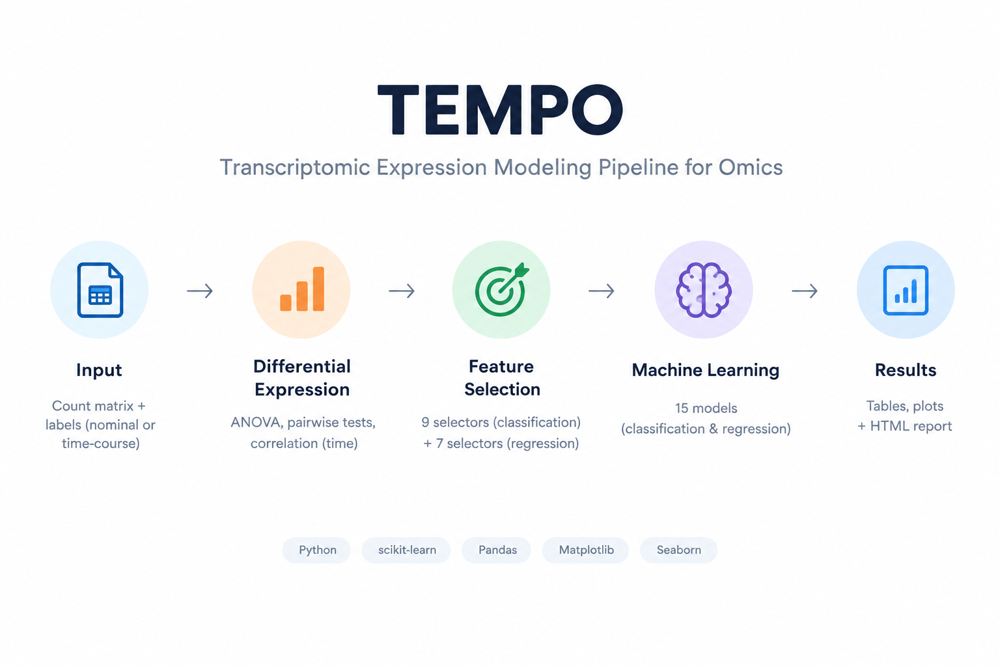

# TEMPO
### Transcriptomic Expression Modeling Pipeline for Omics

[](https://www.python.org/downloads/)
[](https://opensource.org/licenses/MIT)
[](https://scikit-learn.org/)
[]()

> **TEMPO** is a Python pipeline for **differential expression**, **ML-based feature selection**, **gene-trajectory clustering**, and **machine-learning modelling** of bulk RNA-seq data. It supports both **nominal** (e.g., tumor vs. normal) and **time-course**  experimental designs out of the box, and produces publication-ready tables, plots, and a self-contained HTML report.

Developed by **Seyed Ahmad Mousavi** — part of the [ahmadsam66](https://github.com/ahmadsam66) bioinformatics toolkit.

<p align="center">
  
</p>

<p align="center">
  <em>
    <b>Figure 1.</b> TEMPO end-to-end workflow — from a raw count matrix and sample
    labels through differential expression, feature selection, and machine-learning
    modelling, to publication-ready tables, plots, and an HTML report. Supports both
    <b>nominal</b> (e.g. tumor vs. normal) and <b>time-course</b> (e.g. day 0 → 11 → 16 → 45)
    experimental designs.
  </em>
</p>
---

## Table of Contents

1. [Introduction](#1-introduction)
2. [Key Features](#2-key-features)
3. [Installation](#3-installation)
4. [Quick Start](#4-quick-start)
5. [Input File Formats](#5-input-file-formats)
6. [Ten Usage Examples](#6-ten-usage-examples)
7. [Command-Line Options](#7-command-line-options)
8. [How TEMPO Works (Pipeline Internals)](#8-how-tempo-works-pipeline-internals)
9. [Output Files Explained](#9-output-files-explained)
10. [Interpreting Results](#10-interpreting-results)
11. [Reproducibility](#11-reproducibility)
12. [Troubleshooting / FAQ](#12-troubleshooting--faq)
13. [Citation](#13-citation)
14. [Contact](#14-contact)
15. [License](#15-license)

---

## 1. Introduction

Bulk RNA-seq experiments typically end with a gene × sample count matrix and a question like:

- *Which genes distinguish my conditions?*
- *Which minimal gene signature predicts the class?*
- *How do gene-expression programs evolve over time?*
- *Which ML model / feature-selection combination works best?*

**TEMPO** answers all four questions in a single command. It combines:

- **Differential expression** — ANOVA across all groups + pairwise Welch t-tests + Spearman correlation with time.
- **Feature selection** — 9 classification selectors and 7 regression selectors (filter, wrapper, and embedded methods).
- **Machine learning** — 8 classifiers and 7 regressors, evaluated under LOOCV or stratified k-fold.
- **Trajectory clustering** — k-means on z-scored per-gene expression to reveal up/down/transient temporal programs.
- **Visualization** — volcano plots, PCA (raw vs. normalized), ROC curves, heatmaps (global + per-comparison), boxplots, learning curves, confusion matrices.
- **Reporting** — every result written as TSV, plus a single `report.html` dashboard.

TEMPO is designed to be **small-n aware** (auto-selects LOOCV when n ≤ 12), **reproducible** (writes `run_metadata.json` for each run), and **paper-ready** (vector PDFs, BH-FDR correction, stratified CV, log2(CPM+1) normalization).


---

## 2. Key Features

| Feature | Description |
|---|---|
| 🧬 Dual design support | Auto-detects **nominal** (`tumor`/`normal`) vs. **time-course** (`day0`, `day11`, …) from label names |
| 📊 Full DE tables | Every DE TSV includes raw counts, per-class means, CPM, log2FC, statistic, p-value, and BH-FDR |
| 🤖 16 ML feature selectors | 9 for classification + 7 for regression (filter + wrapper + embedded) |
| 🎯 15 ML models | 8 classifiers + 7 regressors, all evaluated under the same CV |
| ⏳ Time-aware | Regression on continuous time + Spearman correlation per gene |
| 🌡️ K-means trajectories | Clusters genes by temporal shape across timepoints |
| 📈 Rich plots | Volcano, PCA (raw + normalized), ROC, AUC bars, heatmaps, boxplots, learning curves |
| 🔬 Small-n aware | Automatic LOOCV for n ≤ 12, adaptive k-fold otherwise |
| 📄 HTML report | Self-contained dashboard with embedded plots and metric tables |
| ♻️ Reproducible | Every run writes `run_metadata.json` with args, versions, and design info |
| 📦 Pure Python | No R, no external binaries; works on Linux, macOS, Windows |

---

## 3. Installation

### 3.1 Prerequisites

- **Python ≥ 3.8** (3.9–3.11 recommended)
- pip (bundled with Python)
- ~500 MB free disk (scikit-learn, scipy, matplotlib, seaborn)

### 3.2 Clone the repository

```bash
git clone https://github.com/ahmadsam66/TEMPO.git
cd TEMPO
```

### 3.3 Create a virtual environment (recommended)

```bash
# Linux / macOS
python3 -m venv .venv
source .venv/bin/activate

# Windows (PowerShell)
python -m venv .venv
.venv\Scripts\Activate.ps1
```

### 3.4 Install dependencies

```bash
pip install --upgrade pip
pip install -r requirements.txt
```

If `requirements.txt` is missing, install directly:

```bash
pip install numpy pandas scipy scikit-learn matplotlib seaborn
```

### 3.5 Verify the installation

```bash
python tempo.py --help
```

You should see the full CLI help. If so, you're ready to run the examples below.

---

## 4. Quick Start

```bash
# 1. Prepare a labels file (see section 5)
# 2. Run TEMPO in one line:
python tempo.py \
    --counts exp_data_raw.tsv \
    --labels labels.tsv \
    --gene_col Gene \
    --outdir results_run1

# 3. Open the report
open results_run1/report.html        # macOS
xdg-open results_run1/report.html    # Linux
start results_run1\report.html       # Windows
```

That's it. TEMPO will:

1. Load counts and labels
2. Auto-detect the experimental design
3. Run DE, feature selection, ML, clustering
4. Write ~30 TSV tables and ~25 PDF plots into `results_run1/`

---

## 5. Input File Formats

TEMPO needs **two files**:

### 5.1 Count matrix (`--counts`)

CSV or TSV. **Genes in rows, samples in columns.** First column (or `--gene_col`) holds gene IDs.

**Example — `exp_data_raw.tsv`:**

```
Gene        day0_rep1  day0_rep2  day11_rep1  day11_rep2  day16_rep1  day16_rep2  day45_rep1  day45_rep2
ZRANB1      814        867        1480        1446        1614        1649        1356        1199
RPS17P5     0          0          0           0           0           0           0           0
DLX3        9          19         24          23          5           9           0           4
TBC1D22B    610        634        300         262         511         492         626         482
```

- Values must be **raw integer counts** (CPM, TPM, or FPKM is *not* raw counts — see [FAQ](#12-troubleshooting--faq)).
- The first column name is used as the gene ID column; pass `--gene_col Gene` to be explicit.

### 5.2 Labels file (`--labels`)

Tab-separated, two columns: **sample ID** and **label**. Sample IDs must match the column names of the count matrix.

**Example — `labels.tsv`:**

```
sample      label
day0_rep1   day0
day0_rep2   day0
day11_rep1  day11
day11_rep2  day11
day16_rep1  day16
day16_rep2  day16
day45_rep1  day45
day45_rep2  day45
```

**Alternative — auto-infer labels from sample-name suffixes:**

```bash
--labels "auto:_tumor,_normal"
```

This assigns labels `tumor` / `normal` based on sample-name suffixes. Only works when the class label is a suffix of the sample name.

### 5.3 Design detection

TEMPO inspects label names and decides:

- If **all labels** match `^[A-Za-z]+[_\-]?\d+(\.\d+)?$` (e.g. `day0`, `week4`, `time_12`), it runs in **time-course mode** — regression on continuous time + Spearman correlation.
- Otherwise it runs in **nominal mode** — pure classification.

You don't need to tell TEMPO which design you have — it figures it out.

---

## 6. Ten Usage Examples

### Example 1 — Minimal run, time-course data

```bash
python tempo.py \
    --counts exp_data_raw.tsv \
    --labels labels.tsv \
    --gene_col Gene \
    --outdir results_basic
```

**Input:** 4 timepoints (day0, 11, 16, 45), 2 replicates each, all genes.
**Output:** Full pipeline: ANOVA DE, pairwise DE (consecutive by default), PCA, k-means, classification, regression, HTML report.

---

### Example 2 — Nominal design (tumor vs. normal)

```bash
python tempo.py \
    --counts TCGA_counts.tsv \
    --labels labels_tumor_normal.tsv \
    --gene_col gene_id \
    --outdir results_tcga
```

**Input:** Two classes, e.g. `tumor` / `normal`.
**Output:** Binary classification (Acc/Prec/Rec/F1/ROC-AUC/MCC); regression is skipped automatically. Volcano uses first-vs-last (equivalent to tumor-vs-normal).

---

### Example 3 — All pairwise comparisons

```bash
python tempo.py \
    --counts exp_data_raw.tsv \
    --labels labels.tsv \
    --gene_col Gene \
    --pairwise_mode all \
    --outdir results_pairwise_all
```

**Input:** Same as Example 1.
**Output:** 6 pairwise DE tables + 6 volcano PDFs + 6 per-comparison heatmaps (every pair of the 4 timepoints).

---

### Example 4 — Consecutive comparisons only

```bash
python tempo.py \
    --counts exp_data_raw.tsv \
    --labels labels.tsv \
    --pairwise_mode consecutive \
    --outdir results_consecutive
```

**Output:** 3 comparisons — `day11_vs_day0`, `day16_vs_day11`, `day45_vs_day16`. The most interpretable for a developmental trajectory.

---

### Example 5 — Strict filtering, small signature

```bash
python tempo.py \
    --counts exp_data_raw.tsv \
    --labels labels.tsv \
    --min_count 20 \
    --min_samples 4 \
    --top_k 15 \
    --outdir results_strict
```

**Use when:** You have deep sequencing and want only robustly expressed genes, plus a tiny biomarker panel.
**Effect:** Filters genes with < 20 counts in < 4 samples. Selects only 15 genes per ML method.

---

### Example 6 — Permissive filtering, wide search

```bash
python tempo.py \
    --counts exp_data_raw.tsv \
    --labels labels.tsv \
    --min_count 3 \
    --min_samples 2 \
    --top_k 200 \
    --top_n_heatmap 60 \
    --outdir results_permissive
```

**Use when:** You have shallow sequencing or want to keep lowly expressed genes (transcription factors, lncRNAs).
**Effect:** Keeps more genes; selects 200 per method; heatmaps show 60 genes.

---

### Example 7 — Custom k-means cluster count

```bash
python tempo.py \
    --counts exp_data_raw.tsv \
    --labels labels.tsv \
    --k_clusters 8 \
    --outdir results_k8
```

**Use when:** You expect more refined temporal programs.
**Output:** `kmeans_clusters_k8.tsv`, `kmeans_clusters_k8.pdf` (grid of 8 trajectory panels).

---

### Example 8 — Force LOOCV (small-n)

```bash
python tempo.py \
    --counts small_n_counts.tsv \
    --labels labels.tsv \
    --cv_mode loocv \
    --outdir results_loocv
```

**Use when:** n ≤ 8 samples total, or you want maximum training data per fold.
**Effect:** Every sample gets predicted by a model trained on all other samples.

---

### Example 9 — Force stratified k-fold

```bash
python tempo.py \
    --counts exp_data_raw.tsv \
    --labels labels.tsv \
    --cv_mode stratified \
    --outdir results_stratified
```

**Use when:** You want standard k-fold for a paper and have ≥ 5 samples per class (TEMPO caps at 5 folds).
**Effect:** StratifiedKFold with n_splits = min(5, smallest class size).

---

### Example 10 — Already-normalized input (skip CPM+log2)

```bash
python tempo.py \
    --counts vst_normalized.tsv \
    --labels labels.tsv \
    --no_log \
    --outdir results_vst
```

**Use when:** You have already applied DESeq2's `vst` or `rlog`, or edgeR's `cpm(log=TRUE)` externally.
**Effect:** Skips the internal CPM + log2 step. Volcano/DE tables still work; the log2FC column becomes "difference of group means" on your provided scale.

---

## 7. Command-Line Options

| Option | Type | Default | Description |
|---|---|---|---|
| `--counts` | path | **required** | Raw count matrix (CSV/TSV) |
| `--labels` | path or `auto:...` | **required** | Labels file, or `auto:_suffix1,_suffix2` |
| `--gene_col` | str | first column | Name of gene-ID column |
| `--outdir` | path | `tempo_results` | Output directory |
| `--top_k` | int | 30 | Genes selected by each ML method |
| `--top_n_heatmap` | int | 40 | Top DE genes shown per heatmap |
| `--k_clusters` | int | 5 | K for k-means gene trajectory clustering |
| `--min_count` | int | 5 | Min count per gene to be kept |
| `--min_samples` | int | 2 | Min samples passing `--min_count` |
| `--no_log` | flag | off | Skip CPM + log2 (use if input already normalized) |
| `--cv_mode` | `auto` / `loocv` / `stratified` | `auto` | CV scheme (auto = LOOCV if n ≤ 12) |
| `--pairwise_mode` | `first_last` / `consecutive` / `all` | `consecutive` | Which pairwise DE comparisons to run |

Run `python tempo.py --help` for the same list from the terminal.

---

## 8. How TEMPO Works (Pipeline Internals)

TEMPO is a single-file Python script that runs the following stages sequentially. Each stage is independent enough that failures are logged and the pipeline continues.

### 8.1 Loading

- Reads counts (CSV or TSV) and labels.
- Validates that all samples have labels.
- Encodes labels as integers in the order TEMPO detects them (for time-course: sorted by time value).

### 8.2 Design detection

```
label  →  regex  →  ^[A-Za-z]+[_\-]?\d+(\.\d+)?$
              │
              ├─ matches all  →  time-course (regression + Spearman)
              └─ otherwise    →  nominal     (classification only)
```

### 8.3 Preprocessing

1. **Gene filtering** — keep genes with `≥ min_count` in `≥ min_samples` samples.
2. **CPM normalization** — counts per million per sample.
3. **log2 transform** — `log2(CPM + 1)` (pseudocount avoids `log(0)`).
4. **Orientation** — matrix is transposed to **samples × genes** for scikit-learn.

Raw counts, CPM, and log2-CPM matrices are all kept in memory so DE tables can report all three.

### 8.4 Differential expression

**Global DE (`global_DE.tsv`):**
- One-way ANOVA across all classes (F, p, BH-FDR).
- log2FC of first vs. last class (from mean CPM).
- For time-course: Spearman ρ of each gene's expression vs. time.

**Pairwise DE (`DE_<cond1>_vs_<cond0>.tsv`):**
- Welch t-test between the two conditions (unequal variance).
- Every table includes raw counts per sample, per-class mean raw counts, per-class mean CPM, log2(CPM+1), log2FC, t-statistic, p-value, BH-FDR.

Comparison set is controlled by `--pairwise_mode`:
- `first_last` → 1 comparison (last vs. first)
- `consecutive` → n−1 comparisons
- `all` → n(n−1)/2 comparisons

### 8.5 Feature selection

**Classification selectors (9):**

| Family | Method |
|---|---|
| Filter | `VarianceThreshold` |
| Filter | `SelectKBest(f_classif)` |
| Filter | `SelectKBest(mutual_info_classif)` |
| Filter | `SelectKBest(chi2)` |
| Wrapper | `RFE(LogisticRegression)` |
| Wrapper | `SequentialFeatureSelector(LogisticRegression, forward)` |
| Embedded | `SelectFromModel(RandomForest)` |
| Embedded | `SelectFromModel(ExtraTrees)` |
| Embedded | `SelectFromModel(GradientBoosting)` |
| Embedded | `SelectFromModel(AdaBoost)` |
| Embedded | `SelectFromModel(LinearSVC, L1)` |

**Regression selectors (7):** equivalent list with `f_regression`, `mutual_info_regression`, `SequentialFeatureSelector(Ridge)`, `RandomForestRegressor`, `ExtraTreesRegressor`, `GradientBoostingRegressor`, `AdaBoostRegressor`, `Lasso`.

### 8.6 Model evaluation

- **Classification CV:** `LeaveOneOut` if n ≤ 12 (auto), else `StratifiedKFold(min(5, smallest class size))`.
- **Regression CV:** `LeaveOneOut` if n ≤ 12, else `KFold(min(5, n))`.
- Predictions are aggregated with `cross_val_predict` (no leakage, no duplicate training data across folds).
- Metrics: Accuracy, weighted Precision / Recall, weighted F1, ROC-AUC (binary or OvR-micro), MCC.
- Regression metrics: R², MSE, MAE, Spearman ρ (predicted vs. true time).

### 8.7 K-means trajectory clustering

1. Compute mean log2(CPM+1) per gene per class → matrix `timepoints × genes`.
2. Z-score each gene across timepoints.
3. K-means on the gene × timepoint matrix (default k = 5).
4. Output: cluster assignment per gene, and a line plot per cluster showing each gene (grey) and the cluster mean (red).

### 8.8 Visualization

All figures are generated with matplotlib/seaborn and saved as **150 dpi PDF** (vector, publication-ready). No plot is shown interactively — the script runs headless.

### 8.9 Reporting

- Every table is written as **TSV**.
- `run_metadata.json` records the exact command-line arguments, timing, versions, design, and class counts.
- `report.html` embeds every PDF plus sortable metric tables.

---

## 9. Output Files Explained

After a run, your output directory will look like:

```
results/
├── report.html                      ← open this first
├── run_metadata.json                ← reproducibility record
├── tables/
│   ├── global_DE.tsv
│   ├── DE_day11_vs_day0.tsv
│   ├── DE_day16_vs_day11.tsv
│   ├── DE_day45_vs_day16.tsv
│   ├── mean_expression_per_timepoint.tsv
│   ├── kmeans_clusters_k5.tsv
│   ├── classification_summary.tsv
│   ├── classification_aggregate_scores.tsv
│   ├── selected_genes_classification.tsv
│   ├── regression_summary.tsv
│   ├── selected_genes_regression.tsv
│   ├── rf_gene_importances.tsv
│   ├── gene_overlap_jaccard.tsv
│   └── confusion_<FS>__<CLF>.tsv
└── plots/
    ├── volcano_day11_vs_day0.pdf
    ├── volcano_day16_vs_day11.pdf
    ├── volcano_day45_vs_day16.pdf
    ├── heatmap_top_de_genes_day11_vs_day0.pdf
    ├── heatmap_top_de_genes_day16_vs_day11.pdf
    ├── heatmap_top_de_genes_day45_vs_day16.pdf
    ├── heatmap_top_de_genes_global.pdf
    ├── heatmap_selected_genes_<FS>.pdf
    ├── pca_raw_vs_normalized.pdf
    ├── kmeans_clusters_k5.pdf
    ├── clf_heatmap_F1.pdf
    ├── clf_heatmap_Accuracy.pdf
    ├── clf_heatmap_MCC.pdf
    ├── auc_bars.pdf
    ├── roc_<FS>.pdf
    ├── feature_importance_rf.pdf
    ├── top_gene_boxplots.pdf
    ├── learning_curve_best.pdf
    └── confusion_<FS>__<CLF>.pdf
```

### 9.1 Key tables

**`global_DE.tsv`** — one row per gene.

| Column | Meaning |
|---|---|
| `count_<sample>` | Raw count in each sample |
| `mean_raw_<class>` | Mean raw count per class |
| `log2FC_first_vs_last` | log2 fold change (last vs first class) |
| `stat` | ANOVA F-statistic |
| `pvalue` | Raw p-value |
| `padj` | Benjamini-Hochberg FDR |
| `spearman_rho` | (time-course only) Correlation with time |
| `p_time`, `padj_time` | (time-course only) Spearman p and FDR |

**`DE_<cond1>_vs_<cond0>.tsv`** — one row per gene.

| Column | Meaning |
|---|---|
| `count_<sample>` | Raw counts for samples in the two conditions |
| `mean_raw_<cond>` | Mean raw count per condition |
| `mean_cpm_<cond>` | Mean CPM per condition |
| `mean_log2cpm_<cond>` | Mean log2(CPM+1) per condition |
| `log2FC` | log2(mean CPM c1 / mean CPM c0) |
| `stat` | Welch t-statistic |
| `pvalue` | Raw p-value |
| `padj` | BH-FDR |

**`classification_summary.tsv`** — one row per (feature selection × classifier) pair:

| Column | Meaning |
|---|---|
| `feature_selection` | Selector name |
| `classifier` | Model name |
| `n_features` | Number of selected genes |
| `Accuracy`, `Precision`, `Recall`, `F1`, `ROC_AUC`, `MCC` | CV metrics |

**`regression_summary.tsv`** — one row per (FS × regressor):

| Column | Meaning |
|---|---|
| `feature_selection`, `regressor`, `n_features` | As above |
| `r2`, `mse`, `mae`, `spearman` | Regression metrics |

**`kmeans_clusters_k<N>.tsv`** — one row per gene:

| Column | Meaning |
|---|---|
| `cluster` | Assigned cluster ID |
| `mean_<time>` | Mean expression per timepoint |
| `z_<time>` | Z-scored mean expression per timepoint |

**`selected_genes_classification.tsv`** — long format:

```
feature_selection   gene
RFE_LogReg          ZRANB1
RFE_LogReg          PAG1
SelectKBest_f_classif   DLX3
...
```

**`gene_overlap_jaccard.tsv`** — pairwise Jaccard similarity between selected gene sets.

### 9.2 Key plots

| Plot | Meaning |
|---|---|
| `pca_raw_vs_normalized.pdf` | PCA on top-variable genes: raw vs. log2(CPM+1) |
| `volcano_<cmp>.pdf` | log2FC vs. −log10(FDR), significant genes highlighted |
| `heatmap_top_de_genes_<cmp>.pdf` | Z-scored expression of top-N DE genes for that comparison, with dendrograms |
| `heatmap_top_de_genes_global.pdf` | Same, but for globally most-significant genes |
| `kmeans_clusters_k<N>.pdf` | Line plots of gene trajectories, one panel per cluster |
| `clf_heatmap_F1.pdf` | Feature-selection × classifier grid colored by F1 |
| `auc_bars.pdf` | Bar chart of ROC-AUC for every model |
| `roc_<FS>.pdf` | Mean ROC curve per classifier under a given FS method |
| `feature_importance_rf.pdf` | Top-N Gini importances from a RandomForest |
| `top_gene_boxplots.pdf` | Per-class expression distributions for top DE genes |
| `learning_curve_best.pdf` | Bias/variance diagnosis for the best model |
| `confusion_<FS>__<CLF>.pdf` | Cross-validated confusion matrix for top-3 models |
| `gene_overlap_jaccard.pdf` | Heatmap of gene-set similarity between methods |

---

## 10. Interpreting Results

<p align="center">
  
</p>

<p align="center">
  <em>
    <b>Figure 2.</b> The machine-learning core of TEMPO. Sixteen feature selectors
    (9 classification + 7 regression) spanning filter, wrapper, and embedded families
    are combined with fifteen models (8 classifiers + 7 regressors). Every combination
    is evaluated under a small-n–aware cross-validation scheme (LOOCV or stratified
    k-fold) and reported as metrics (Accuracy / F1 / ROC-AUC / MCC / R²) plus
    visualizations (ROC curves, confusion matrices, feature importance, learning curves).
  </em>
</p>

### 10.1 Which classifier/FS combo should I trust?

Look at **`classification_summary.tsv`** and pick combos with:

- **High F1 AND high MCC** — F1 can look inflated by class imbalance; MCC is more robust.
- **Stable across FS methods** — if RandomForest is best under 5 different selectors, the model is solid; if it's only best under one, it's likely overfitting.
- **Reasonable number of features** — a "best" model with 500 genes for n=8 is not a signature.
- **Learning curve shape** — if train F1 >> CV F1, the model overfits. If both are high, the model is trustworthy.

### 10.2 Which genes are real?

Cross-reference:

1. **`global_DE.tsv`** — `padj < 0.05` → statistically significant.
2. **`selected_genes_classification.tsv`** — genes selected by ≥ 3 different selectors.
3. **`kmeans_clusters_k<N>.tsv`** — cluster membership matching your biological prior (e.g., "genes going up over time").

The **intersection** of DE-significant genes and genes selected by multiple methods is your most credible candidate list.

### 10.3 Time-course interpretation

- **Spearman ρ > 0.7 & padj_time < 0.05** → monotonic up-regulation over time.
- **Spearman ρ < −0.7 & padj_time < 0.05** → monotonic down-regulation.
- **ANOVA significant but Spearman non-significant** → transient (e.g., peak at day16).
- **K-means cluster** → visualize the shape directly; clusters like "V-shape" or "plateau" are common in developmental data.

### 10.4 Red flags

- **AUC < 0.6** → classes are not separable from expression alone.
- **R² < 0** in regression → the model is worse than predicting the mean.
- **Very wide CV error bars** (see `clf_cv_boxplot_f1.pdf`) → the model is unstable across folds.
- **Very high F1 with only 1 feature** → suspicious; likely data leakage or a batch effect confound.

---

## 11. Reproducibility

Every run produces **`run_metadata.json`** containing:

- Pipeline name and version
- Timestamp and runtime
- Exact command-line arguments
- Number of genes and samples after filtering
- Detected design (nominal / time-course)
- Class order and counts
- CV scheme used

Copy this JSON into your paper's supplementary material — anyone can rerun the exact same analysis.

Random seeds are fixed (`random_state=42`) in all stochastic components (RandomForest, KMeans, PCA, StratifiedKFold, etc.).

---

## 12. Troubleshooting / FAQ

### Q1. My data is CPM/TPM/FPKM, not raw counts. Can I use TEMPO?

**Yes**, but pass `--no_log`. TEMPO will skip its internal CPM + log2 step and treat your values as already-normalized. If your values are already log-transformed (e.g., DESeq2 `vst`), also pass `--no_log`.

### Q2. TEMPO crashes with "sample missing in labels file."

Your labels file sample IDs must exactly match the count matrix column names (case-sensitive). Check for spaces, tabs, or trailing `_`.

### Q3. Can I use a CSV instead of a TSV?

Yes. TEMPO auto-detects separator by file extension (`.csv` → comma, `.tsv`/`.txt` → tab).

### Q4. I have only 6 samples. Will classification still work?

Yes, TEMPO will auto-switch to **LOOCV**, which trains on 5 samples per fold and tests on 1. Metrics will be noisy — treat them as exploratory, and rely more on the DE table + heatmaps.

### Q5. What's the difference between `global_DE.tsv` and `DE_*.tsv`?

- `global_DE.tsv` → ANOVA across **all** classes at once; one F/p per gene. Tests "is this gene different *anywhere*?"
- `DE_*.tsv` → one file per pairwise comparison; Welch t-test per gene. Tests "is this gene different *between these two specifically*?"

### Q6. How do I add a new feature-selection method?

Open `tempo.py`, find `get_feature_selectors_classification` or `..._regression`, and add a scikit-learn compatible selector:

```python
"MyNewMethod": MySelector(n_features_to_select=k),
```

No other change required.

### Q7. The run is slow. How can I speed it up?

- Reduce `--top_k` (e.g., 20).
- Reduce `--pairwise_mode` to `consecutive` or `first_last`.
- Exclude costly selectors (`SequentialFeatureSelector`, `RFE`) by editing `get_feature_selectors_*`.
- Most of the time is spent in `cross_val_predict` over 9 × 8 combinations — that's inherent to the design.

### Q8. Where is the version info?

```bash
python tempo.py --version  # if you added a --version flag
```

Or check `PIPELINE_VERSION` at the top of `tempo.py`.

### Q9. Can TEMPO handle multi-class (>2) labels?

Yes. ROC becomes OvR-micro-averaged, confusion matrices are class × class, MCC is generalized.

### Q10. Can I cite TEMPO in a paper?

Absolutely — see [Citation](#13-citation).

---

## 13. Citation

If you use TEMPO in your research, please cite:

```bibtex
@software{tempo2024,
  author    = {Mousavi, Seyed Ahmad},
  title     = {{TEMPO}: Transcriptomic Expression Modeling Pipeline for Omics},
  year      = {2024},
  publisher = {GitHub},
  url       = {https://github.com/ahmadsam66/TEMPO}
}
```

Plain text:

> Mousavi, S.A. (2024). *TEMPO: Transcriptomic Expression Modeling Pipeline for Omics* [Computer software]. GitHub. https://github.com/ahmadsam66/TEMPO

---

## 14. Contact

📞 **Need Help?**

For assistance integrating this tool into your workflow or customizing the analysis:

**Seyed Ahmad Mousavi**
📧 [ahmad.moousavi@gmail.com](mailto:ahmad.moousavi@gmail.com)
🔗 GitHub: [@ahmadsam66](https://github.com/ahmadsam66)

Related project: [Acmg-variant-classifier](https://github.com/ahmadsam66/Acmg-variant-classifier)

Bug reports and feature requests are welcome via [GitHub Issues](https://github.com/ahmadsam66/TEMPO/issues).

---

## 15. License

This project is released under the **MIT License**. You are free to use, modify, and redistribute the code for academic and commercial purposes, provided the original author is credited.

See [`LICENSE`](LICENSE) for the full text.

---

*Last updated: 2024 — TEMPO v1.0*
